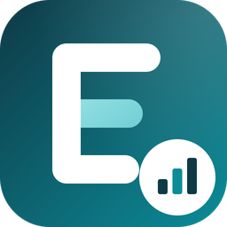
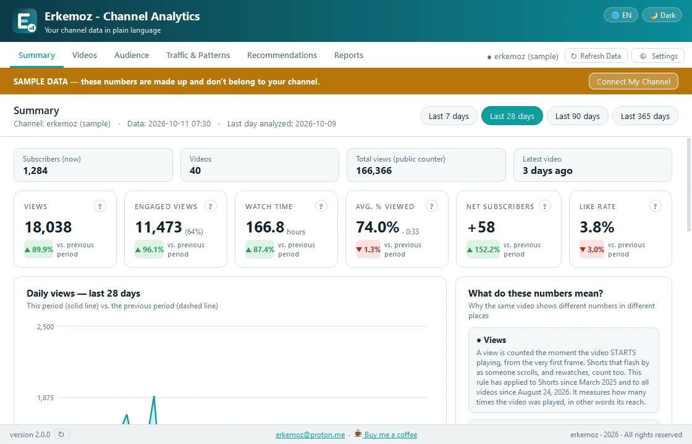
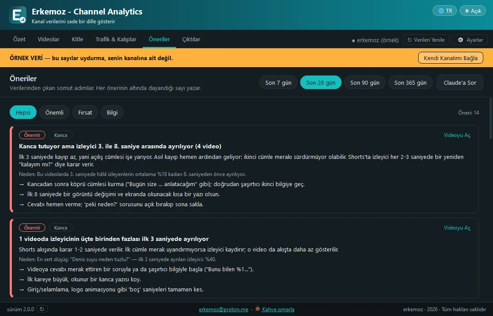

  

<h1 align="center">Erkemoz - Channel Analytics</h1>

  <b>YouTube kanalının verilerini sade bir dille gösteren ücretsiz program — Windows</b> 
  <i>Free app that explains your YouTube channel data in plain language — Windows</i>

  <a href="https://github.com/erkemoz-wq/erkemoz-channel-analytics/releases/latest"><b>⬇ Son sürümü indir · Download the latest version</b></a> 
  <code>ErkemozChannelAnalytics_Kurulum_x.y.z.exe</code> · Windows 10 / 11 (64-bit) 
  🌐 <a href="https://erkemoz.app/channel-analytics/">erkemoz.app</a>

  
  &nbsp;&nbsp;
  

---

## Türkçe

### Neler yapar
- Kanalının verilerini YouTube Data ve YouTube Analytics API'leriyle, **yalnız okuma izniyle** indirir. Kanalında hiçbir şeyi değiştiremez.
- Görüntüleme, izlenme süresi, abone ve etkileşimi önceki dönemle karşılaştırır; her sayının ne anlama geldiğini sade bir dille açıklar.
- Her videoya, kanalındaki diğer videolara göre 100 üzerinden puan ve **A–D notu** verir; tutunma eğrisini ve ilk saniyelerdeki kaybı gösterir.
- Kitle ve trafik: yaş, cinsiyet, ülke, cihaz, trafik kaynakları ve seni bulduran aramalar.
- Hangi video uzunluğunun, yayın gününün, saatin ve başlık tarzının daha iyi gittiğini bulur; verilerden somut öneriler çıkarır.
- Süzülüp sıralanabilen **Excel raporu**, tek sayfalık **PDF özeti** ve bir yapay zekâ asistanına yapıştırabileceğin Markdown özeti hazırlar.
- Hesap bağlamadan önce örnek veriyle gezebilirsin. 8 dil, açık ve koyu tema; yeni sürüm çıkınca program haber verir.

### Kurulum
1. Yukarıdaki bağlantıdan kurulum dosyasını indir ve çalıştır.
2. Windows **"Bilgisayarınız korundu"** (SmartScreen) derse **Ek bilgi → Yine de çalıştır**'a tıkla. Bu uyarı, program henüz ücretli bir kod imzalama sertifikasıyla imzalanmadığı için çıkabilir.
3. Program, Google'a **senin açacağın kendi Google Cloud projen** üzerinden bağlanır. Adımlar programın Ayarlar penceresinde yazıyor; bir kez, yaklaşık 5 dakika sürer.

### Gizlilik
Kanal verilerin, video kapakları ve Google oturumun yalnız bu bilgisayarda durur; oturum Windows'un kendi şifrelemesiyle (DPAPI) korunur. Program yalnız Google'ın sunucularıyla konuşur; verilerin bizim ya da başkasının sunucusuna gönderilmez. Kaç bilgisayarda kurulu olduğunu saymak için yalnızca **rastgele bir kurulum numarası, sürüm, arayüz dili ve programın açık olup olmadığı** gönderilir; sunucu IP adresini kaydetmez. Ayarlar'daki **"Anonim kullanım istatistiği gönder"** kutusunun işaretini kaldırırsan hiçbir şey gönderilmez. Ayrıntılar: [Gizlilik Politikası](https://erkemoz.app/privacy/)

### Bilmen gerekenler
- YouTube analiz verisini 1–3 gün geriden işler; program da o veriyi gösterir.
- Program makine koduna derlenir ve her açılışta kendi dosyalarının mührünü denetler; değiştirilmiş bir kopya açılmaz. **Yalnızca bu sayfadaki resmi sürümü indir.**
- 🛡 Her sürüm yayınlanırken otomatik olarak **VirusTotal**'da taranır; raporun linki ve sonucu [sürüm notunda](https://github.com/erkemoz-wq/erkemoz-channel-analytics/releases/latest) yazar.
- YouTube, Google LLC'nin ticari markasıdır. Bu program Google ya da YouTube ile bağlantılı değildir.

---

## English

### Features
- Downloads your channel data through the YouTube Data and YouTube Analytics APIs with **read-only access**. It cannot change anything on your channel.
- Compares views, watch time, subscribers and engagement with the previous period and explains every figure in plain language.
- Gives every video a score out of 100 and an **A–D grade** against your own channel's videos, with its retention curve and the drop-off in the first seconds.
- Audience and traffic: age, gender, country, device, traffic sources and the searches that found you.
- Shows which video lengths, publish days, times and title styles perform best, and turns your data into concrete recommendations.
- Creates an **Excel report** you can filter and sort, a one-page **PDF summary** and a Markdown summary you can paste into an AI assistant.
- Explore with sample data before connecting an account. 8 languages, light and dark theme; the app tells you when a new version is out.

### Installation
1. Download the installer from the link above and run it.
2. If Windows shows **"Windows protected your PC"**, click **More info → Run anyway**. This can appear because the app is not yet signed with a paid code-signing certificate.
3. The app connects to Google through **a Google Cloud project you create yourself**. The steps are in the app's Settings window; it's a one-time setup of about 5 minutes.

### Privacy
Your channel data, video thumbnails and Google sign-in stay only on this computer; the sign-in is protected with Windows' own encryption (DPAPI). The app talks only to Google's servers; your data is never sent to our servers or anyone else's. To count how many computers it is installed on, it sends only **a random installation number, the version, the interface language and whether the app is running**; the server does not store your IP address. Uncheck **"Send anonymous usage statistics"** in Settings and nothing is sent. Details: [Privacy Policy](https://erkemoz.app/privacy/)

### Good to know
- YouTube processes analytics data with a 1–3 day delay; the app shows that data.
- The app is compiled to native code and verifies its own files on every start; a modified copy will not run. **Only download the official release from this page.**
- 🛡 Every release is automatically scanned on **VirusTotal**; the report link and result are in the [release notes](https://github.com/erkemoz-wq/erkemoz-channel-analytics/releases/latest).
- YouTube is a trademark of Google LLC. This app is not affiliated with or endorsed by Google or YouTube.

---

☕ Program işine yaradıysa / If it helps you: <a href="https://buymeacoffee.com/erkemoz"><b>Bana bir kahve ısmarla · Buy me a coffee</b></a>

© erkemoz · <a href="mailto:erkemoz@proton.me">erkemoz@proton.me</a> · Ücretsizdir / Free to use · Değiştirilip dağıtılamaz / Do not modify or redistribute

